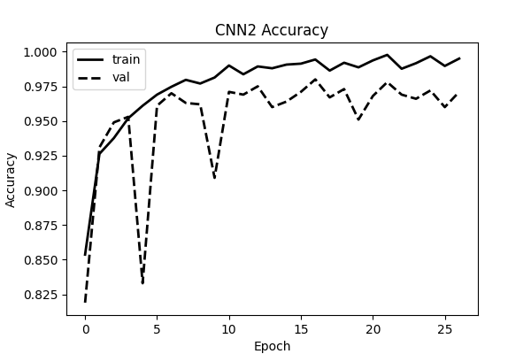
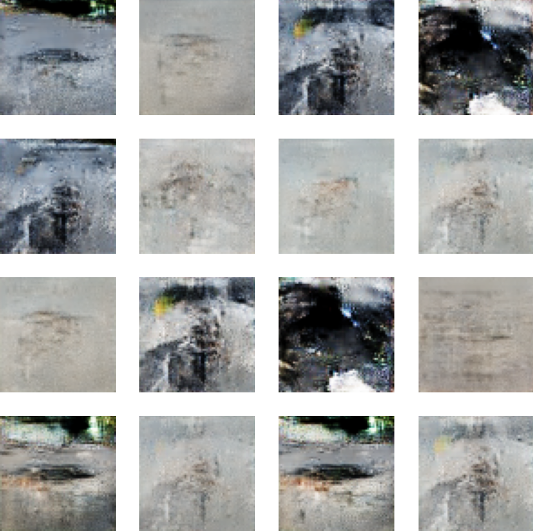

# Pothole Detection with Neural Networks

Binary classification of road images comparing a fully connected network, two convolutional neural networks, and a VGG16-style network built using TensorFlow and Keras. The project also includes classical image processing visualization and a GAN trained to generate synthetic pothole images.

Models were analyzed using early stopping on validation accuracy and test accuracy was measured once after training on a held-out 20% set.

## Results

| Model | Test Set Accuracy |
|---|---|
| FCN   | 87.6%             |
| CNN1  | 96.5%             |
| CNN2  | 97.7%             |
| VGG16 | 96.6%             |

Highest test set accuracy plot:

GAN Output:

See pothole-detection-notebook for final test set accuracies for each model. As can be seen from results/ the GAN generated image quality is limited based on computational power and insufficient training data necessary for a higher performing GAN. In future iterations, additional datasets will be aggregated together to improve the photorealism of these images so that they start to more closely resemble the input images.

## Dataset

Source: Normal-Pothole-dataset, Neha Tanwar (Researcher), 2024. https://zenodo.org/records/13334878

dataset-samples/ contains samples of images from the dataset shown as ground truth, along with corresponding filtering applied to the images.
